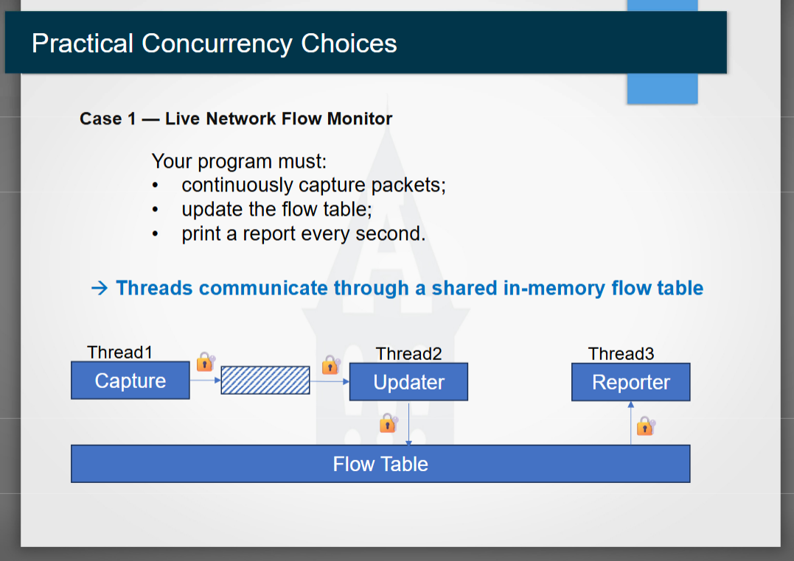

# Some notes for milestone 2 

## Plan 
- implement multi threading first 
- then make a flow table

Step 1
- choose a flow table
- create a flow table and update it?

Step 2
- updating the record
- look at flow table
- update packet and byte totals

Step 3
- this could be the step where we implement multithreading?
- output formatting changes , timing clarification

Some Notes on Multithreading
Program will be split into three threads 
- capturer
- updater 
- reporter

Shared data
- Capturer and updater will share a locked queue
- Updater and reporter will share a locked table

Diagram for Threading provided in class


#### Psuedocode for step 3
```
// ---- Shared state ----
PacketQueue:
    queue of packets
    lock
    signal (wakes the consumer when data arrives)

FlowTable:
    table data
    lock

running = true


// ---- Thread 1: Capture ----
function CaptureThread():
    while running:
        packet = capturePacket()

        acquire queueLock
            queue.push(packet)
        release queueLock

        signal Updater that a packet is available

    signal Updater one last time (so it can wake up and exit)


// ---- Thread 2: Updater ----
function UpdaterThread():
    loop forever:
        acquire queueLock
            wait until (queue is not empty) OR (running is false)

            if queue is empty AND running is false:
                release queueLock
                exit loop

            packet = queue.pop()
        release queueLock

        acquire flowTableLock
            updateFlowTable(table, packet)
        release flowTableLock


// ---- Thread 3: Reporter ----
function ReporterThread():
    while running:
        sleep 1 second

        acquire flowTableLock
            printReport(table)
        release flowTableLock


// ---- Main ----
function main():
    start CaptureThread
    start UpdaterThread
    start ReporterThread

    wait for shutdown signal
    running = false

    wait for all three threads to finish
```


# Meeting Notes

## Meeting on 10/7 time 3:00-4:00
Evaluation criteria 4
- sort by packets and sort by bytes?
- use concurrency to continuously get packets without disrupting other processes 

- make separate threads for caputure and report 
- lock/unlock - make sure processes don't read and write at the same time

### Divide and Conquer
- Multithreading : Jayne
	- split up the capture and updater, diagrma on canvas - use page 26 of concurrency 1 on lecture slides
	- the diagram on page 25 is NOT correct
- Part 1 : Emberly
	- try to have it implemented
- Part 2 : Gannon 
	- try to make sense of what the instructions are actually telling us to do

**next meeting (10/14): research our topic, have pseudocode, attempt to implement it before meeting**

## Meeting On 10/14 time 3:00-5:00
So far: done minimal research. Beginning implementation today

Implementing Step 1
- step 2 and step 1 are very intertwined, some parts overlap
- flow key was given to us in the starter code
- need to add number of bytes to the flow key

- `pcap_capture` and `packet_parser` will not be touched in part 1 or 2

- updater and capturer need to be in different files -> made new files `updater.cpp` and `updater.hpp`
- packetparser sends `packetinfo` into the updater, which the updater splits them into `flowkey` and `flowstats` 

Flow aggregator -?
- flowtable needs to be accesed by all threads
    - flowaggregator should be in a separate file, so we need new files `flow_aggregator.cpp` and `flow_aggregator.hpp`
    - instantiate `flow_aggregator` class in main
    - pass references to the `flowaggregator` in other functions
    - `flowaggregator` will hold `flowtable` and functionality for updating and reporting aka `addingpackets` function and method for getting active flows, which will be used by the reporter
    - **locks** are important -- will be implemented in step3

Flow aggregator
- does everything so get rid of flow updater
- make flow key and flow stats during the update method, which will be its own thread
- during update it needs to add the packet to the flowtable
- making the flow table in the flow aggregator?

Conclusion: step 1 and step 2 are going to be done at the same time
- make the updater
- reporter needs current flow table, snapshot is making a copy of what the flow table is at the moment

main doesnt have a header file because it is the entry point
- only need headers when you are calling something

## Meeting 10/15 time 5:00-6:30
Accomplishments
- **finished step 1 !! ** (to our knowledge)
- **finished step 2 !! ** (to our knowledge)
- Starting step 3.... 
	- for each loop for each item in flow snapshot, print each item in flow
	- updating the reporter function	

So for step 3 
- one thread updating one thread snapshotting
- occasionally print snapshots according to clock selected.

Notes
- instead of capturing 10 packets, make it run for like 15 seconds?
- need to implement multi threading 
- got a warning about storage not being persistent,, look at this next meeting

### For Next meeting 10/20
try to have step 1 and 2 done by tuesday
- a lot of the flow aggregator class is done

Jayne: keep researching about multithreading. make some threads that work. 
- thread that calls updater function and thread that calls reporter function
- look into making a locked queue
