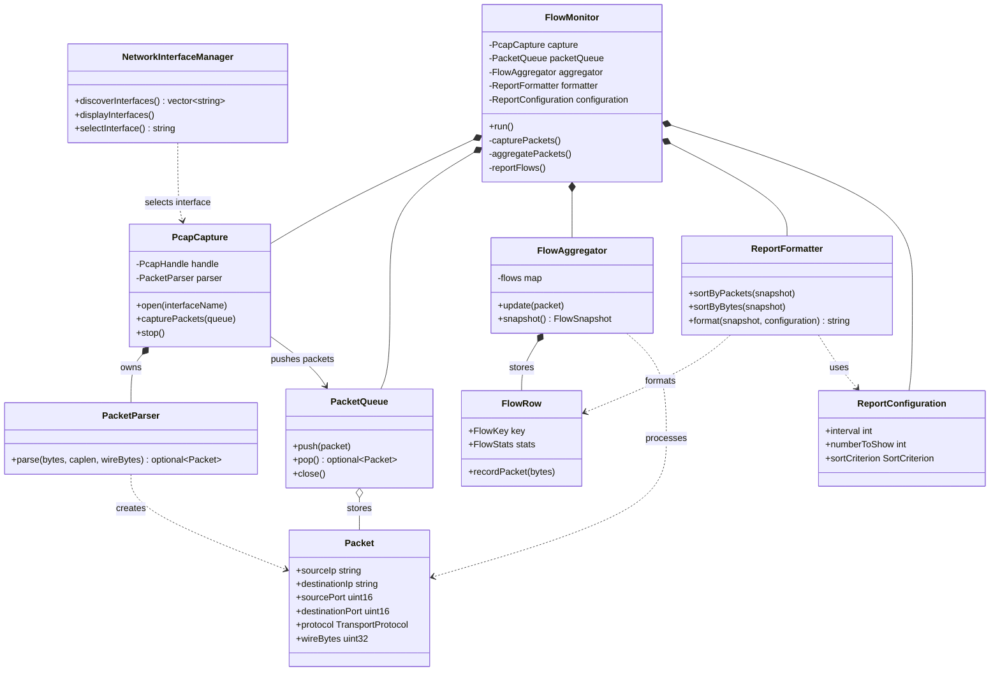

# 1. Requirements Analysis
- [x] descirbe what the system should do
- [ ] make each requirement clear and testable
- [x] use requirement IDs (R1, R2, and R3)

This system captures live network flow for TCP and UDP packets. The program prints off live flow reports in a specified interval. Flow is sorted by number of packets or number of bytes specified by the user. The system uses threads to maintain persistent flow records.

| ID | Requirement |
| :------ | :------- |
| R1 | capture flow packets as they become available |
| R2 | allow the user to select and open an interface |
| R3 | report TCP or UDP (differenciate between them) |
| R4 | interrupting the program stops the program clearly without abnormal termination |
| R5 | user selects interval, reports every interval |
| R6 | each report shows one row per directional 5 tuple (flow) | 
| R7 | user selects byte sort mode or packet sort mode and sorts in descending order by # of packets or # of bytes |
| R8 | byte statistics and packet reporting are persistent accross reports (updates instead of new) |
| R9 | user selects # of displayed flow rows |

# 2. System Design
Describe how you plan to organize your project using C++ classes. Design should include
- [ ] major classes: explain the responsibility, important data members, and main functions/interfaces of each class
- [ ] class relationships: provide a UML class diagram or equivalent diagram showing how the classes are related (composition, inheritance, or usage)
- [ ] class interactions: explain how the classes work together to implement the major system functionality 

## Major Classes
| Class | Responsibility | Important data members | Main functionality/interface | 
| :------ | :-------: | :------: | :------: |
| Class1 |  |  |  |

The program is already partially object-oriented: PacketQueue, FlowAggregator, and Reporter are classes, while PacketInfo, FlowKey, and FlowStats are data structures. The main opportunity is to move responsibilities currently spread across free functions and main.cpp into cohesive classes.

Suggested classes
|Class	 | Responsibility	| Existing code to move |
| :------ | :-------: | :------: | 
| NetworkInterfaceManager	| Discover interfaces, display them, validate the user’s selection	| get_and_display_interfaces() | 
| PcapCapture	| Own the pcap_t handle and capture packets |	open_pcap_handle(), capture_loop() |
| PacketParser | Convert raw Ethernet/IP/TCP/UDP bytes into PacketInfo |	parse_headers() |
| Packet |	Represent a parsed packet with addresses, ports, protocol, and size	| Replace or wrap PacketInfo |
| FlowRow |	Represent one communication flow and update its statistics | Combine FlowKey and FlowStats |
| FlowAggregator	| Store flows, update them, and produce snapshots |	Keep existing FlowAggregator |
| ReportConfiguration	| Store interval, number of flows, and sorting choice	| Input variables in main() |
| ReportFormatter	| Sort and format flow data for display	| Keep existing Reporter |
| FlowMonitor	| Coordinate capture, queue processing, aggregation, and reporting threads | Most of main.cpp |

## UML diagram 

**focus on explaining how your design satisfies these requirements, rather than simply listing classes and functions**

# 3. Test Design
Design tests to verify the major requirements and system functionality. For each test, provide:
- [ ] target: the requirement or component being tested
- [ ] input/setup: the input or conditions required
- [ ] expected result: the expected behaivior or output.
[ ] include normal cases and important error/edge cases.
- [ ] briefly explain how your planned tests covered the major requirements.
**tests only need to be designed in this milestone, they will be implemented and executed in the final milestone**

